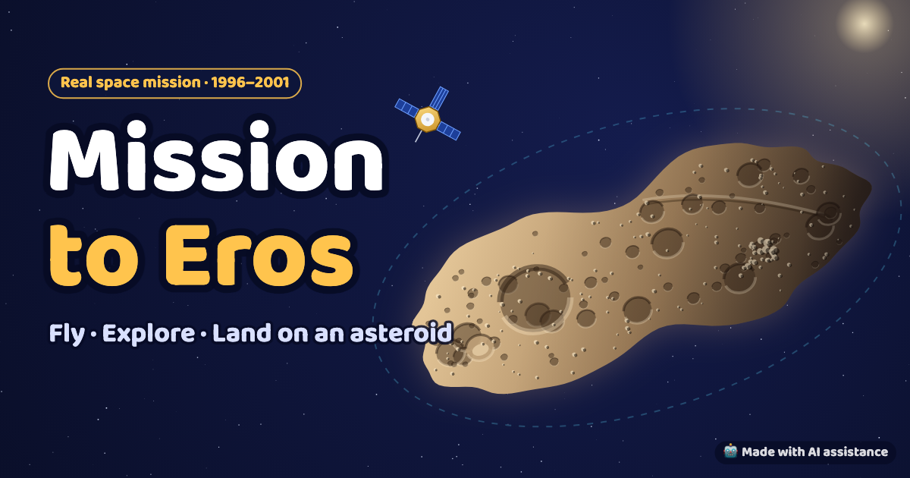

# Mission to Eros

A free browser game for kids about NEAR Shoemaker, the first spacecraft to orbit an asteroid (433 Eros, 2000) and the first to land on one (2001).

**Play:** https://bogdan-srk.github.io/mission-to-eros/ · Ukrainian version: [`?language=ua`](https://bogdan-srk.github.io/mission-to-eros/?language=ua)

## The game

Three stages, about 5 minutes, works with keyboard, mouse or touch:

1. **Approach Eros:** launch from Cape Canaveral (February 1996), fly past the asteroid Mathilde and swing around Earth. Collect science flasks to speed up and unlock facts.
2. **Explore:** scan six real surface features of Eros: Psyche crater, the Himeros saddle, a boulder field, the long ridge, dust ponds and its very weak gravity.
3. **Land:** touch down gently in the landing zone, like NEAR did on 12 February 2001.

## Tech

- **One file, [index.html](index.html):** HTML, CSS and plain JavaScript, with no frameworks and no image or sound files.
- **Graphics and sound:** all graphics are drawn in code with Canvas 2D; sound effects are generated with the Web Audio API.
- **Languages:** English by default, Ukrainian with `?language=ua`.
- **Hosting and analytics:** hosted on GitHub Pages; visits are counted with GoatCounter, which uses no cookies.
- **Share images:** [tools/covers/render.sh](tools/covers/render.sh) draws the share images with the game's own drawing code, using Bash, headless Google Chrome and Python.

To run it locally, open `index.html` in a browser, or run `python3 -m http.server` and open http://localhost:8000.

## How AI was used

This project was built with help from AI assistants: JetBrains Junie, and Claude Code by Anthropic.

| Area | What AI helped with |
|---|---|
| Coding, debugging, troubleshooting | Game code, the launch animation, analytics, the cover generator, link-preview fixes |
| Writing, editing, translation | Game text and facts, the Ukrainian translation, this README |
| Visual design and image creation | In-game art (drawn by AI-assisted code) and the share images `cover.png` / `cover-mobile.png` |
| Research | Mission facts: dates, places, the Delta II rocket |
| Ideation | Cover concepts, feature ideas |

The share images carry a visible **"Made with AI assistance"** watermark. The game's title screen says the same, and `index.html` includes an `ai-disclosure` meta tag.

The author directed the project, chose between options and tested the game.
